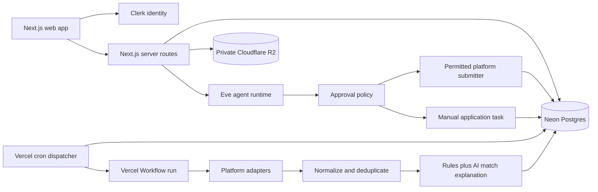

# JobPilot v2 implementation plan

Status: active  
Target: multi-tenant SaaS on Vercel, Neon Postgres, and private Cloudflare R2  
Primary markets: Poland and Ukraine

## 1. Product outcome

JobPilot turns a candidate profile and CV into a controlled job-search pipeline:

1. collect recent vacancies from user-selected countries and platforms;
2. normalize, deduplicate, and score them;
3. automatically prepare or submit only the applications covered by an explicit user policy;
4. put every other application into a human approval queue;
5. track each application and publish a per-run and historical summary.

The system is an application assistant, not an indiscriminate bot. It must use official APIs or explicitly permitted integration paths first. It must not bypass CAPTCHAs, anti-bot controls, access restrictions, or a platform's application flow. Unsupported and external application flows become manual tasks with a deep link and prepared materials.

## 2. Non-negotiable rules

- Every persisted user-owned record is scoped to a tenant and owner.
- Platform credentials are never exposed to the model, browser, logs, or database in plaintext.
- CV objects are private; access is granted with short-lived, tenant-checked signed URLs.
- Every external write is idempotent and auditable.
- Application submission is human-approved by default. A future auto-submit policy must be explicit, narrow, revocable, and platform-compliant.
- Jobs older than seven days are never eligible. A job with an unverified publication date may be shown for manual review but is never auto-submitted.
- Previously proposed jobs are not proposed again unless the user explicitly reopens them.
- Scheduled executions use the schedule's IANA timezone and process a fixed calendar window, not “the last 24 hours.”

## 3. Architecture



### Runtime boundaries

- **Next.js 16:** dashboard, onboarding, Clerk-protected APIs, CV upload/download contracts, approval UI.
- **Eve:** durable agent sessions, typed tools, human-in-the-loop approval prompts, and tenant-projected runtime context.
- **Neon + Drizzle:** tenant data, schedules, leased run queue, normalized vacancies, proposals, applications, approval requests, audit trail, and Eve session ownership.
- **Cloudflare R2:** private CV originals and future generated application artifacts. Neon stores metadata and object keys only.
- **Vercel Cron:** invokes one small dispatcher frequently. User schedules remain rows in Neon.
- **Vercel Workflow:** one durable, retryable pipeline per claimed search run.

Application-owned scheduling is deliberate. Eve's creator-owned dynamic schedules currently require an organization-level feature flag and do not serve preview deployments by default. A Neon-backed dispatcher gives us portable tenancy, catch-up, leasing, and deterministic job windows.

## 4. Scheduling semantics

Each schedule stores `timezone`, local run time, cadence, enabled platforms, and per-platform limits.

- Daily occurrence for local date `D`: `[D-1 00:00, D 00:00)` in the schedule timezone.
- Weekly occurrence for local date `D`: `[D-7 00:00, D 00:00)` in the schedule timezone.
- Manual run: user-selected lookback from one to seven days, ending at request time.
- The dispatcher atomically leases due occurrences. A successful run advances exactly one occurrence. Missed occurrences are caught up sequentially, subject to an operational backlog cap.
- DST days may contain 23 or 25 hours; the calendar boundary remains correct.
- `published_at < window_start`, `published_at >= window_end`, or age over seven days is ineligible.
- Unique proposal keys and run idempotency keys make retries safe.

## 5. Connector capability levels

Each platform adapter advertises capabilities instead of pretending every board supports the same workflow:

| Level | Capability | Result |
| --- | --- | --- |
| Discover | Official feed/API or permitted search | Vacancy can enter matching pipeline |
| Prepare | Generate answers/materials without submitting | Draft plus manual task |
| Submit | Official or permitted first-party application endpoint | Approval-gated submission |
| Track | Application status API or verified user update | Timeline event |

Initial target adapters: LinkedIn, Just Join IT, No Fluff Jobs, DOU, and Djinni. An adapter ships only after its current terms, access method, rate limits, and authentication flow are documented. Browser automation is not a fallback for bypassing restrictions.

## 6. Data model

Core aggregates:

- tenant, user, and tenant membership;
- candidate profile and CV document;
- platform integration and encrypted credential reference;
- search schedule, enabled schedule platform, and search run;
- normalized job posting and tenant-owned proposal;
- application, approval request, and append-only application event;
- agent session owner and audit event.

Global job records are deduplicated by `(platform, external_id)`. A proposal is unique by `(tenant, owner, job)`, which prevents a previous vacancy from resurfacing in later runs.

## 7. Application lifecycle

```text
discovered -> proposed
proposed -> approval_required | approved | manual_required | dismissed
approval_required -> approved | dismissed | expired
approved -> applying | manual_required
applying -> submitted | failed | outcome_unknown
manual_required -> submitted | dismissed | outcome_unknown
submitted -> acknowledged | interview | rejected | offer | withdrawn
acknowledged -> interview | rejected | offer | withdrawn
interview -> rejected | offer | withdrawn
failed -> applying | manual_required | dismissed
```

Every transition appends an event containing actor type, actor ID, reason, idempotency key, and safe metadata. Direct status overwrites are not allowed.

## 8. Delivery phases

### Phase 0 — secure foundation (implemented locally)

- [x] Bootstrap a new Node 24 Eve project and keep the current Sites prototype unchanged.
- [x] Add the official Eve Next.js web channel.
- [x] Add Clerk sign-in/sign-up and protected application routes.
- [x] Add the Drizzle schema and generated initial migrations.
- [x] Add private R2 presigned upload/finalization contracts.
- [x] Add exact timezone-aware search-window calculation with DST tests.
- [x] Add application state-machine validation with tests.
- [x] Add a responsive dashboard shell and empty states.
- [x] Add a Cron dispatcher and durable Workflow skeleton with database ownership and retry safety.

Acceptance criteria: typecheck, unit tests, Eve build, and Next production build pass without live secrets. Live database commands and local runtime startup remain blocked until Vercel linking and environment validation are complete.

Phase 0 provides working infrastructure and UI contracts, not live job-board discovery. Schedules intentionally remain paused until at least one compliant discovery connector is implemented and connected.

### Phase 1 — onboarding and control plane

- [x] Persist candidate profile, countries, titles, work modes, languages, exclusions, and salary preferences.
- [x] Add a durable CV parsing pipeline with fail-closed malware/content checks and a user-confirmed extracted profile.
- [x] Add an integration catalog with capability and connection state.
- [x] Add schedule CRUD with timezone preview and per-platform search/apply limits.
- [x] Add a run-now action and run-history dashboard.

Local acceptance gates pass: tenant-scoped application paths are implemented; typecheck, 16 focused unit tests, the Eve build, and the Next.js production build pass. Live acceptance still requires linked Clerk, a migrated Neon development branch, private R2, and a configured private malware scanner. No discovery connector is implemented in Phase 1, so queued runs terminate in a visible waiting state rather than fabricating results.

### Phase 2 — discovery and matching

- Implement one compliant discovery adapter end-to-end before adding more.
- Normalize source records, canonicalize URLs, and persist source snapshots.
- Deduplicate globally and suppress earlier tenant proposals.
- Combine hard rules with explainable match scoring.
- Produce run counts: found, new, duplicate, eligible, proposed, and failed.

Acceptance criteria: replaying a run or retrying a step creates no duplicate proposal or side effect.

### Phase 3 — approvals and applications

- Approval inbox with approve, reject, edit, and bulk-review controls.
- Cover-letter and screening-answer drafts grounded only in candidate-confirmed facts.
- First compliant direct-submit adapter with idempotency and receipt capture.
- Manual task flow for external application pages.
- Application timeline and user correction tools.

Acceptance criteria: no application is submitted without a per-job approval or a stored eligible standing policy; a retry cannot submit twice.

### Phase 4 — additional platforms and operations

- Add Just Join IT, No Fluff Jobs, DOU, Djinni, and LinkedIn only at supported capability levels.
- Rate limiting, backoff, connector health, and per-source circuit breakers.
- Email/in-app summaries and actionable failure alerts.
- Admin support tools with impersonation prohibited and audited support grants.

Acceptance criteria: connector failure is isolated, reported, and resumable without corrupting other platform work.

### Phase 5 — enterprise readiness

- Security review, threat model, dependency and secret scanning.
- Data export/deletion, retention controls, consent history, and privacy documentation.
- Backup/restore drill, SLOs, alerting, cost budgets, and incident runbooks.
- Load and tenancy-isolation tests.

Acceptance criteria: production readiness checklist approved and restore exercise completed.

## 9. Environment and deployment gates

Required secret names are documented in `.env.example`; real values never enter Git.

Deployment order:

1. create/link the Vercel project;
2. provision Clerk and validate production redirect URLs;
3. attach Neon and verify `DATABASE_URL` in all intended Vercel environments;
4. create a private R2 bucket and least-privilege API token;
5. pull environment variables without printing their values;
6. generate and inspect migrations, then apply to a non-production branch;
7. build and run smoke tests;
8. deploy preview, test auth/tenancy/upload end-to-end, then promote.

No migration, seed, development server, or deployment is run before these gates are satisfied.

## 10. Key product metrics

- eligible jobs and new proposals per run;
- duplicate suppression rate;
- approval rate and median time to decision;
- successful submissions, manual tasks, and failures by platform;
- interview conversion by source and match band;
- connector success/latency and schedule delay;
- cost per completed run and per submitted application.

